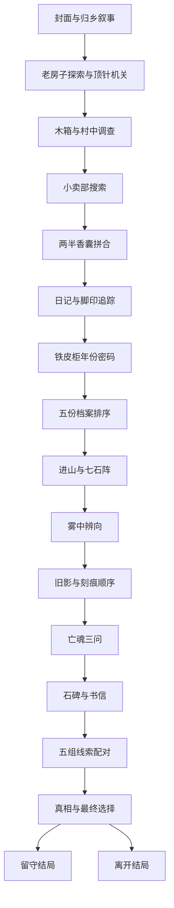

# 雾落村样例准备说明

本样例展示一条数据从原始清单、完整资源、游戏流程、判分设计到实际界面验证的交付方式。它是工程准备样例，不代表已取得模型通关成绩，也不代表题目难度和内容质量已通过正式题库审核。

## 资源与接入

- 原始记录：`base664:0601`，作品为《雾落村·槐香引》，完整作品一单元。
- 保存入口 HTML 和九张原站图片，图片合计 5,770,954 字节。原始 HTML、准备后的 HTML 和所有图片均记录 SHA-256。
- 使用本机静态服务器，不需要模拟后端。游戏没有外部脚本、远端 API、登录或音频依赖。
- 发现原作生成 HTML 时未转义事件属性中的双引号，导致“拿起顶针”按钮失效。仅在第 495 行增加引号转义；反向还原此改动后与原始页面文本完全一致。没有调整答案、选项或推进条件。
- `BrowserHarness` 提供截图、可见文字和可操作元素；模型 API 决定动作；`Judge` 读取独立判分文件。静态服务只能访问游戏目录，裁判与验收脚本不在托管范围内。
- 原始材料来自公开页面；目前交付为本地评测副本，未对外发布。

## 全流程

脚本声明 35 个场景：封面 1 个、叙事 20 个、谜题界面 11 个、最终选择 1 个、结局 2 个。完整逐场景节点和边保存在 `flow.json`。本作除最后的叙事选择外为串行流程。

两种结局均为正式叙事收束。源码没有第三个隐藏结局、死亡结局或游戏失败终止分支；错误解谜会重试或保持原场景。结局页面附带的彩蛋是叙事内容，不是额外可操作路线。

## 谜题点与计分粒度

原裁判只记钥匙、密码和石阵三项，无法覆盖整个作品。本样例将十组需要判断后操作的任务拆成 21 个可独立验证的点：

1. 顶针机关：1 点。先决线索发现是流程依赖，不额外加分。
2. 香囊拼合：方向和对齐各 1 点；最后的确认点击不再加分。
3. 脚印追踪：1 点。把连续追踪当成一个顺序任务。
4. 铁皮柜年份密码：1 点。
5. 档案排序：5 点。每份档案的放置都有独立正误检查，分别记录。
6. 七石阵：1 点，不按七次点击重复计分。
7. 雾中辨向：1 点。三个场景重复同一规则，不重复计分。
8. 刻痕顺序：1 点。
9. 亡魂问答：3 点，每问独立判定。
10. 线索配对：5 点，每对独立判定。

小卖部搜索是推进所必需的探索，但没有独立的推理正误检查，记录为事件。翻页、查看线索、拿取物品、查看提示和最终叙事选择均不因操作次数增加主分。

每个点的成功证据是游戏已经设置的 DOM 成功状态或已获得物品，不读取输入值来猜测是否正确；每步判定后由裁判锁存，后续换场景不会丢失。两条结局共用同一组必经点。21 点目前等权；文档明确保留十个任务组，便于之后比较按任务组归一化的方案，而不是掩盖粒度对权重的影响。

具体证据表达式、依赖场景及源码行号在 `checkpoint-spec.json`。不把这些内容提供给被测模型。

## 验证方法和结果位置

`verify_sample.py` 使用 `BrowserHarness.act` 真实点击界面，读源码只用于生成裁判侧验收路径；不注入游戏状态，不直接调用推进或通关函数。两条路线从新上下文开始，检查初始零进度，验证实际到达的场景与结局。正向操作之外，还检查错误方向、错误密码、错误排序、错误问答和全部错误线索配对不会得分。

- `verification/acceptance.json`：完整场景覆盖、判分状态、错误操作测试和异常记录。
- `verification/*.png`：实际浏览器画面。
- `configs/samples/wuluo-cun-api-smoke.json`：最多四步真实 API 连通性验证配置。
- `runs/wuluo-cun-api-smoke/`：API 尝试的标准 harness 日志；早期 402 失败记录保留。充值后的最新运行及原站 L3 运行均完成四步截图 API 测试，详细证据见 `data/preparation/harness-api-smoke.json`。

界面验收结果只证明资源、路径与判分能工作，不能替代模型成绩。最终结果以 `acceptance.json` 的 `pass` 字段为准。

本次最终验收通过：35/35 个场景覆盖、两个结局分别从新上下文走通、两条路线均触发 21/21 个判分点。70 次负向或不计分操作检查没有误加分；包括全部 20 个错误线索配对。两条路径分别执行 209 次和 94 次真实界面点击，最终无页面脚本异常或 HTTP 资源错误。标准 `run_one --policy script` 也正常退出并生成单局日志。核心测试 30 项通过。

游戏资源包在 `packs/wuluo-cun.sample.zip`，对应清单为 `packs/wuluo-cun.sample.manifest.json`。ZIP 内容只含游戏资源，已检查 CRC；不含裁判、验收路径或 API 配置。解压到仓库根目录会恢复 `tasks/wuluo-cun/mirror/`。

## 正式收录前的内容质量问题

- 部分题面的提示已经非常直接，雾中辨向连续三次重复同一个判断。不能仅因有正误反馈，就认定每一项都具有较高推理难度。
- 亡魂第三问有两个语义非常接近的选项，但原程序只接受其中一个。这可能测到措辞偏好，不能用工程修复擅自改成另一套题。该问题保留在题库审核记录中。
- 原作没有明确的好坏结局评级。用户已确认两种结局都算正式通关、只记录具体结局。配置用 normal 表示未区分好坏；“好结局率”在本题上不用于解读。
- 完整模型局预算尚未校准。真实模型 API 的本地与在线短程通路已验证，尚未执行完整模型通关测试。

因此本样例可供检查数据准备结构和工程验证方法，但不能将它标为内容审核与模型评测均已完成。
