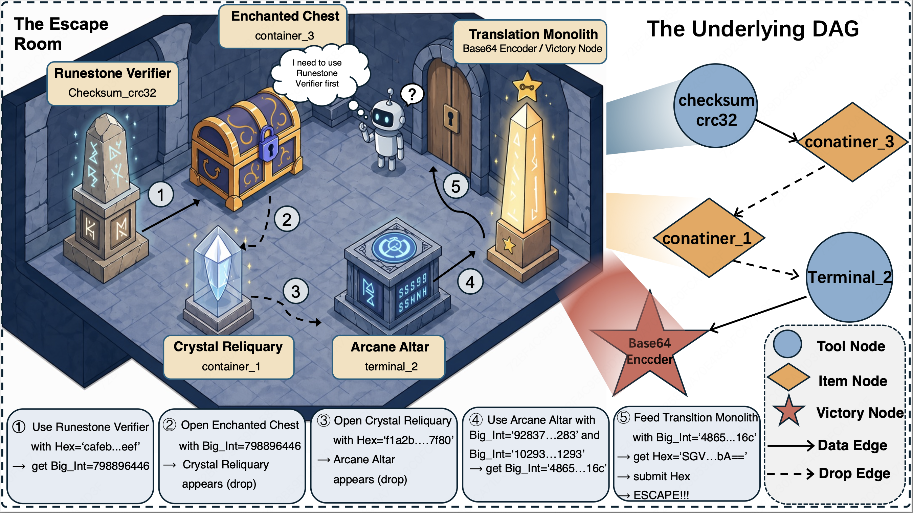

<p align="center">
  
  
  
  
</p>

<h1 align="center">AgentEscapeBench</h1>

<p align="center">
  <b>Evaluating Out-of-Domain Tool-Grounded Reasoning in LLM Agents</b>
</p>

<p align="center">
  A comprehensive benchmark for assessing LLM agents' ability to perform multi-step, compositional tool-use reasoning in novel environments — framed as procedurally-generated "escape room" challenges.
</p>

---

## Overview

**AgentEscapeBench** evaluates whether LLM-based agents can discover, reason about, and correctly chain unfamiliar tools to solve complex dependency graphs — a critical capability for real-world deployment where agents encounter tools outside their training distribution.

Unlike existing benchmarks that test agents on pre-memorized APIs, AgentEscapeBench presents agents with **procedurally generated** scenarios where:

- Tools and items are **novel** — not seen during model training
- Dependencies form **directed acyclic graphs (DAGs)** of varying complexity
- Agents must **explore**, **reason about interfaces**, and **plan multi-step solutions**
- Narrative framing ensures scenarios are **semantically unfamiliar** to prevent shortcut heuristics

<p align="center">
  
</p>

## Key Features

| Feature | Description |
|---------|-------------|
| **Procedural Generation** | Automated pipeline produces unlimited unique scenarios with controllable difficulty |
| **DAG-based Complexity** | Scenarios are structured as dependency graphs (5–25 nodes), requiring multi-hop reasoning |
| **40+ Tool Templates** | Cryptography, encoding, file operations, math, graph algorithms, and more |
| **8 Narrative Styles** | Cyberpunk, detective noir, sci-fi, fantasy, steampunk, post-apocalyptic, mystery, techno-thriller |
| **Fine-grained Metrics** | Beyond pass/fail — measures node discovery, dependency resolution, parameter accuracy, and tool-call efficiency |
| **15+ Model Support** | GPT-4o, GPT-5, Claude Opus 4, Gemini 3, DeepSeek, Qwen, Kimi K2, MiniMax, Doubao, and more |
| **Human Evaluation Client** | Web-based interface for human baseline comparison |
| **Bilingual Support** | Full English and Chinese prompt systems |

## Architecture

```
┌─────────────────────────────────────────────────────────────────┐
│                    AgentEscapeBench Framework                     │
├─────────────────────────────────────────────────────────────────┤
│                                                                   │
│  ┌──────────────┐    ┌──────────────┐    ┌──────────────────┐   │
│  │   Scenario   │    │  Evaluation  │    │    Analysis &    │   │
│  │  Generation  │───▶│    Server    │───▶│     Metrics      │   │
│  └──────────────┘    └──────────────┘    └──────────────────┘   │
│         │                    ▲                                    │
│         ▼                    │                                    │
│  ┌──────────────┐    ┌──────────────┐                           │
│  │  DAG Skeleton │    │  LLM Agent   │                           │
│  │  + Narrative  │    │  (under test)│                           │
│  └──────────────┘    └──────────────┘                           │
│                                                                   │
└─────────────────────────────────────────────────────────────────┘
```

The framework operates in three stages:

1. **Scenario Generation** — Procedurally generates DAG-structured puzzles with tool/item nodes, edges representing data dependencies, and immersive narratives
2. **Interactive Evaluation** — A FastAPI server simulates the environment; agents interact via `investigate`, `tool_call`, `use_item`, and `submit_answer` actions
3. **Trajectory Analysis** — Post-hoc fine-grained metrics computed from agent interaction trajectories

## Benchmark Statistics

| Difficulty (Nodes) | Scenarios | Avg. Edges | Avg. Critical Path |
|:------------------:|:---------:|:----------:|:-----------------:|
| 5                  | 60        | 4          | 3–4               |
| 10                 | 60        | ~9         | 5–7               |
| 15                 | 60        | ~14        | 7–10              |
| 20                 | 60        | ~19        | 9–13              |
| 25                 | 30        | ~24        | 11–16             |

**Total: 270 unique scenarios** across 5 difficulty levels.

## Quick Start

### Prerequisites

```bash
pip install fastapi uvicorn pydantic requests openai google-generativeai anthropic flask
```

### 1. Start the Evaluation Server

```bash
python server.py
```

The server runs at `http://localhost:8000` by default.

### 2. Run Evaluation on a Single Scenario

```bash
python run_evaluation.py \
  --config config_batch/gpt-5.json \
  --case-file questions/10/narrative/skeleton_091c541b_narrative.json \
  --language en
```

### 3. Batch Evaluation

```bash
python batch_evaluate.py \
  --config config_batch/gpt-5.json \
  --difficulties 5 10 15 \
  --parallel 4
```

### 4. Multi-Model Evaluation

```bash
chmod +x evaluate_all_models.sh
./evaluate_all_models.sh
```

## Configuration

Model configurations are JSON files in `config_batch/`:

```json
{
  "model": "gpt-5",
  "agent_type": "chat_completions",
  "api_key": "your-api-key",
  "base_url": "",
  "temperature": 0.7,
  "max_tokens": 8192,
  "max_history": 500,
  "use_function_calling": true,
  "server_url": "http://localhost:8000",
  "max_steps": 50,
  "output_dir": "results/gpt-5"
}
```

### Supported Agent Types

| Agent Type | Models | Features |
|-----------|--------|----------|
| `chat_completions` | GPT-4o, GPT-5 | OpenAI Chat Completions + Function Calling |
| `responses` | GPT-5, GPT-4.1 | OpenAI Responses API |
| `deepseek_chat` | DeepSeek-Chat | Non-reasoning mode |
| `deepseek_reasoner` | DeepSeek-Reasoner | Chain-of-thought reasoning |
| `gemini` | Gemini 3 Flash/Pro | Google AI with thinking levels |
| `claude` | Claude Opus/Sonnet | Native tool use + extended thinking |
| `qwen` | Qwen3 series | DashScope compatible |
| `minimax` | MiniMax-M2 | Interleaved thinking |
| `doubao` | Doubao-Seed-2.0 | ByteDance with reasoning effort |

## Scenario Generation

Generate new scenarios with controllable difficulty:

```bash
./generate_dag_v2.sh \
  --count 10 \
  --difficulty 15 \
  --droppable-ratio 0.3 \
  --config config/narrative_yuju_v2.json
```

The pipeline:
1. **DAG Skeleton** — Generates graph structure with typed nodes and edges
2. **Source Annotation** — Identifies source nodes and initial values
3. **Parameter Filling** — Fills concrete values respecting type constraints
4. **Validation** — Ensures solvability and structural correctness
5. **Narrative Wrapping** — LLM generates immersive story framing

### Tool Categories

| Category | Examples |
|----------|----------|
| Number Theory | `calc_bigmul`, `calc_modexp`, `calc_gcd`, `calc_inv_mod` |
| Hashing | `hash_sha256`, `hash_md5`, `hmac_sha256` |
| Encoding | `base64_encode/decode`, `hex_encode/decode`, `zlib_inflate/deflate` |
| Cryptography | `crypto_aes_cbc_decrypt`, `crypto_rsa_decrypt_hex` |
| File Operations | `zip_unzip`, `json_get`, `csv_query`, `regex_search` |
| Graph Algorithms | `graph_shortest_path` |
| Miscellaneous | `num_base_convert`, `time_convert`, `checksum_crc32`, `geo_haversine`, `luhn_check` |

## Evaluation Metrics

### Main Metrics

| Metric | Description |
|--------|-------------|
| **Success Rate (SR)** | Fraction of instances where the agent produces the correct victory-node output and submits it successfully. An episode is scored as success if and only if the final answer matches the ground-truth value. |
| **Sub-problem Resolution Rate (Sub.)** | Average fraction of DAG nodes correctly resolved per instance. Provides a fine-grained view of partial progress beyond the binary success rate. |
| **Hidden-Node Discovery Rate (Disc.)** | Average fraction of initially hidden nodes that the agent successfully uncovers during an episode by triggering the incremental-disclosure (drop) mechanism. |

### Fine-Grained Trajectory Analysis

Beyond aggregate metrics, we perform systematic offline analysis of every evaluation trajectory along three complementary dimensions:

#### Behavioural Pattern Analysis

| Metric | Direction | Description |
|--------|:---------:|-------------|
| **Source-Node Convergence Speed** | Lower is better | Average number of tool-call attempts before a source node (leaf with no data-flow predecessors) is correctly resolved. Measures how effectively a model exploits structured per-parameter feedback. |
| **Premature Invocation Rate** | Lower is better | Fraction of non-source node invocations made before all data-flow predecessors have been resolved. Probes reasoning ability (correct execution order) and working memory (tracking solved vs. pending nodes). |
| **Clue Adherence Rate** | Higher is better | Fraction of downstream invocations whose argument values trace back to actual upstream outputs. Low adherence indicates the model substitutes guessed values rather than faithfully propagating intermediate results. |

#### Tool-Calling Error Taxonomy

Every failed tool invocation is classified into error categories via structured server feedback:
- **Missing Required Parameter** — Failure to enumerate the complete parameter set
- **Wrong Node Type** — Incorrect identification of which nodes are executable tools
- **Wrong Call Format** — Systematic format adherence failure for unfamiliar APIs
- **Repeated Solved Node** / **Node Not Visible** / **Node Not Exist** — Other structural errors

#### Efficiency Analysis

| Metric | Description |
|--------|-------------|
| **Average Tool Calls** | Mean number of tool calls consumed per instance. Fewer calls indicate more directed problem-solving with less redundancy. Compared against a theoretical lower bound (minimum required calls). |

### Run Trajectory Analysis

```bash
cd trajectory_analyze
python run_all_metrics.py --results-dir ../results/ --questions-dir ../questions/
```

## Human Evaluation Client

A web-based interface for collecting human performance baselines:

```bash
# Start the evaluation server first
python server.py

# Launch the human client
cd Human_Client
python app.py
```

Access at `http://localhost:8419`. Supports multi-player concurrent sessions with per-user progress tracking.

## Project Structure

```
AgentEscapeBench/
├── server.py                    # FastAPI evaluation server
├── simulator.py                 # Tool execution simulator (40+ tools)
├── evaluator.py                 # Evaluation orchestrator
├── run_evaluation.py            # Single-scenario evaluation launcher
├── batch_evaluate.py            # Multi-scenario parallel evaluation
├── evaluate_all_models.sh       # Multi-model batch script
├── models.py                    # Data models (Node, Edge, GraphScenario)
├── agents/                      # Model agent implementations
│   ├── base_agent.py            # Abstract base class
│   ├── chat_completions_agent.py
│   ├── responses_agent.py
│   ├── deepseek_chat_agent.py
│   ├── deepseek_reasoner_agent.py
│   ├── gemini_agent.py
│   ├── claude_agent.py
│   ├── qwen_agent.py
│   ├── minimax_agent.py
│   ├── doubao_agent.py
│   └── factory.py               # Agent factory
├── config_batch/                # Model configuration files
├── questions/                   # Benchmark scenarios
│   ├── 5/narrative/             # 60 scenarios (5 nodes)
│   ├── 10/narrative/            # 60 scenarios (10 nodes)
│   ├── 15/narrative/            # 60 scenarios (15 nodes)
│   ├── 20/narrative/            # 60 scenarios (20 nodes)
│   └── 25/narrative/            # 30 scenarios (25 nodes)
├── dag_skeleton_generator.py    # DAG structure generation
├── dag_parameter_filler.py      # Parameter value filling
├── narrative_generator2.py      # LLM-based narrative generation
├── validate_dag.py              # DAG validation
├── generate_dag_v2.sh           # End-to-end generation pipeline
├── assets.py                    # Tool/item template definitions
├── prompt_en.py                 # English prompt templates
├── language_config.py           # Bilingual support
├── trajectory_analyze/          # Post-hoc analysis tools
│   ├── compute_fine_grained_metrics.py
│   ├── extract_node_discovery_rate.py
│   ├── stat_avg_tool_calls.py
│   └── run_all_metrics.py
├── Human_Client/                # Web UI for human evaluation
│   ├── app.py
│   └── index.html
└── complexity_statistic/        # Scenario complexity analysis
```

## Adding a New Model

1. Create an agent class in `agents/` extending `BaseModelAgent`
2. Register it in `agents/factory.py`
3. Create a configuration JSON in `config_batch/`
4. Run evaluation:

```bash
python batch_evaluate.py --config config_batch/your-model.json
```

## Citation

```bibtex
@article{agentescapebench2026,
  title={AgentEscapeBench: Evaluating Out-of-Domain Tool-Grounded Reasoning in LLM Agents},
  year={2026}
}
```

## License

This project is released under the MIT License. See [LICENSE](LICENSE) for details.

---

<p align="center">
  <i>AgentEscapeBench — Can your agent think its way out?</i>
</p>
